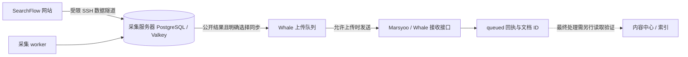

# SearchFlow 全功能测试反馈 · 2026-10-27

正式站：<https://searchflow.20-150-145-162.sslip.io/>

本轮已执行完整自动化、真实浏览器操作、三来源线上采集及真实平台上传。结论：已测试的主要交互与采集链路可用；仍存在 **Trends API CSV 缺少相关报道**、**平台最终入库读取权限不足** 两项限制，不能据此宣称所有数据出口和平台最终处理均已验收。

**执行结果**

| 验证层次 | 本轮实际结果 | 证据与边界 |
|---|---|---|
| 完整 Python 测试 | 452 项通过，0 失败、0 跳过 | 启用独立 PostgreSQL / Redis；修复后再次全量运行，13.575 秒 |
| 正式站 HTTP / 数据审核 | 62 项检查通过 | 16 种时间窗口 / 来源组合、鉴权、私有隔离、导出与汇总一致性 |
| 本地浏览器交互 | 44 组通过，未捕获脚本异常 | 19 组基础、18 组写操作、7 组边界；搜索上游及平台使用模拟响应 |
| 正式浏览器交互 | 9 组通过，未捕获脚本异常 | 三来源、真实详情/下载、分析、平台回执、桌面和手机 |
| 正式三来源搜索 | 3 次成功，均非缓存 | 共新增 3 条私有搜索请求；幂等重放没有创建第二份任务 |
| 正式三来源平台上传 | 3 条均一次取得 queued | 使用已有公开链接；有 document_id，最终业务状态读取返回 401 |
| 下载校验 | CSV 可解析、各行列数一致；JSON / JSONL 可解析 | 正式网页三来源 CSV 均为 44 列；API CSV 为 7 列，Trends 完整性限制见下文 |

53 是浏览器**测试组**数量，每组包含多次操作与断言；不与 452 个 Python 用例混为同一口径。“通过”只覆盖各组明确断言，不代表未开放功能、长期稳定性或所有数据字段的真实性。

**具体功能覆盖**

| 功能 | 实际操作 / 数据核对 | 结果与范围 |
|---|---|---|
| 九个页面与来源入口 | 概览、任务、数据集、分析、监测、API、平台、设置、创建；三来源图标完成加载 | 本地及正式通过 |
| 搜索与结果 | 全局快捷键、清理旧条件、来源/关键词/日期/新链接、空状态、上下页、显示密度持久化 | 本地通过；正式三来源筛选通过 |
| 详情与复制 | 单条详情、同请求多条记录切换、来源语义、CSV、剪贴板内容 | 本地通过；正式三来源详情通过 |
| 批量导出 | CSV / JSONL、取消、模拟 503 后恢复按钮、筛选条件 | 本地通过；正式下载文件校验通过 |
| 任务向导 | 三种模板、空关键词拒绝、纯 Trends 无关键词、地区语言、预算、返回上一步、确认 | 本地通过；没有在生产创建持续任务 |
| 任务状态 | 保存待启动、创建并开始、启动/暂停/恢复/停止、筛选、分页、任务结果跳转 | 本地通过；真实采集由线上客户 API 小任务核验 |
| 数据偏好 | 正文开关写入、恢复关闭 | 仅本地开启再关闭；生产正文保持关闭 |
| 分析总览 | 统计表、每日图表、来源/地区/语言、关键词搜索与分页、目录定位、JSON / CSV | 本地及正式通过；正式 16 种窗口/来源组合复算 |
| 排名与竞品 | 同条件双快照，从第 5 名升至第 2 名；目标/竞品、分布、页面排序、变化导出 | 合成数据精确对照通过；正式历史报告与竞品渲染通过 |
| 分析边界 | 缺失排名、缓存去重、重返、标题摘要变化；错误重试、在途改筛选、快速切换、空报告 | Python / 本地浏览器通过，不虚构缺席排名 |
| API 接入 | 管理权限连接/断开、错误密钥、客户连接/用量、三来源调试、任务详情与下载 | 本地通过；正式三来源真实请求通过 |
| API 权限与额度 | 幂等、额度原子预留/结算、失败和取消释放、空间隔离、撤销密钥、UTC 月上限/限流 | Python 通过；浏览器验证取消、撤销与跨租户 404；正式验证私有详情 404 |
| 关键词监测 | 默认暂停、开始、实际本地调度、成功采样、暂停、报告 | 本地通过；未在生产启动监测 |
| 平台同步 | 草稿、恢复/暂停/停止、上传开关、数据回执弹层 | 本地通过；正式各来源 1 条上传通过 |
| 手机与可访问性 | 320 / 390 像素全部九页无页面横向溢出；菜单焦点/Escape、图表焦点、目录 | 本地及正式通过；截图已目视检查 |
| 品牌与商业入口 | Google 来源标识、本地 Material SVG、账户分配入口隐藏 | 本地及正式通过；未增加付费/销售功能 |

本地浏览器写操作使用当前网站代码、真实隔离数据库及 Redis，搜索响应和平台客户端为模拟。为避免高频验收操作触发每分钟 60 次限制，本地写测试在组间清理了**独立测试库**的限流窗口；真实限流机制由 Python 集成用例验证，生产限流未改。

**真实线上搜索与数据出口**

| 来源 | 任务 ID | 实际上游 | 原始结果 | API CSV |
|---|---|---|---:|---|
| Web | `2390196d-e5c2-4244-9e3f-e64ff8ed7b4e` | OpenSERP，非缓存 | 9 条自然结果 | 9 行、9 个链接 |
| News | `898f49d8-b35b-41e5-93fe-4d3b4e3e7bec` | Google RSS，非缓存 | 47 条新闻 | 47 行、47 个链接 |
| Trends | `ab74de8f-f6b7-4e7f-9df7-ef584c651cb6` | Google RSS，非缓存 | 10 个话题，28 条相关报道 | 10 行话题、0 个报道链接 |

三任务成功各计 1 次；客户用量从 1 增至 4，最终预留为 0。每来源使用固定 Idempotency-Key 重放，均复用同一任务。任务原始详情公开访问返回 404，新增私有数据未进入公开分析或公开上传队列。

Trends 的 JSONL 保留 28 条相关报道。**API 七列 CSV 当前没有展开 articles**，只导出话题，无法用于完整的报道链接分析。网页的 44 列 CSV 可展开相关报道，已下载的正式历史样本为 30 行。此处属于数据出口能力差异，本轮未修改 API 结构；现阶段需要完整数据时使用 JSONL 或网页 CSV。

正式网页下载样本：Web 7 行、News 86 行、Trends 30 行，均 44 列。它们来自公开历史记录，与上表本次私有 API 搜索是不同数据集，数量不能互相比较。验证没有逐条重新访问全部历史外链，也没有把 RSS 顺序当自然排名。

**网站、采集服务器与平台如何保存数据**

- 网站直接使用采集服务器上的同一份数据库；不是网站、采集服务器各保存一份独立库。采集成功后，结构化请求和结果保存在这里。
- 保存到本站**不自动等于保存到 Marsyoo**。普通任务需勾选“结果同时加入 Whale 上传队列”，或在“平台同步”选择已有链接入队，再开启允许上传。私有客户 API 结果不默认发送到平台。
- 本次平台测试使用既有公开 Web / News / Trends 各 1 个未在本地 Outbox 中出现的网址；三条各尝试一次，均无错误，取得新回执。没有为了测试恢复平台任务领取或持续采集。

| 来源 | 上传任务 ID | 返回文档 ID | 当前能证明的状态 |
|---|---|---|---|
| Web | `f0da6079-801e-4fd3-b97e-e7001ed65bee` | `doc_6344a24575b64f0f0697c137a1eb715c` | queued |
| News | `d2a6da11-c9f4-4e27-999a-e8cb6fab5b12` | `doc_a50b8bfd331b1fa99bf55f11260e5f6f` | queued |
| Trends | `b9618c79-4c7c-4809-a8b8-e923641cf119` | `doc_67866c2c5fa517c0f63066e322071df4` | queued |

平台回执还返回 version_id 与 `outbox_event_created=false`。这些是接收接口的返回字段，不能当作本次新建文档、最终 published 或索引完成的证据。使用现有 Collector Key 对上述三个 `/v1/documents/{id}` 进行读取，均返回 **401**；最终平台状态本次未能核验。历史验收曾看到 published，不替代本次验证。

**本轮发现和处理**

| 问题 | 影响 | 处理结果 |
|---|---|---|
| 切换每日图表指标后新数据点丢失 tabindex / ARIA | 键盘用户无法聚焦新图表并查看提示 | 已修复、正式站复验通过 |
| API 页宣称“固定首屏 10 条上限” | 与 News 实际返回 47 条不符 | 已按各来源实际语义更正文案、正式站复验通过 |
| Trends API CSV 未展开相关报道 | CSV 没有 28 条报道链接 | 已实证并保留为待改项；JSONL / 网页 CSV 可获取 |
| 平台最终文档读取 401 | 无法证明内容中心/索引最终状态 | 需要平台具备读取权限的身份继续核验；未绕过权限 |

仅更新 `realtime/workbench_ui.py`，只重启 Web；生产备份：`state/fullqa-ui-fix-20261027/workbench_ui.py.before`。未覆盖生产有差异的 `web.py`、`serp_page.py`，二者部署前后 SHA-256 保持一致；未改 worker、未执行历史迁移、未添加商业功能、未提交 Git。

首次浏览器脚本中的严格定位、多选记录数量、等待和中文回执断言问题已纠正后重新运行；最终 53 组通过。测试脚本问题没有计为产品缺陷，也没有将早期失败日志冒充验收通过。

**全量数据与结束状态**

| 核对项 | 测试前 | 测试后 | 解释 |
|---|---:|---:|---|
| 原始搜索请求 | 39,832 | 39,835 | 仅新增本轮 3 次私有 API 搜索 |
| 公开请求 / 分析请求投影 | 39,830 / 39,830 | 39,830 / 39,830 | 无漏投影、无私有数据混入 |
| 分析明细 | 810,068 | 810,068 | 全量扫描排名/网址/host 三项约束，违规均 0 |
| 历史 pages 记录 | 332,768 | 332,768 | 未启动正文采集 |
| Whale queued 回执 | 6 | 9 | 新增 3 条真实上传回执 |
| 启用的监测 | 0 | 0 | 没有恢复生产监测 |

持续采集、正文、Whale 上传、平台任务领取最终全部为 **false**。Web 与 SSH 隧道服务 active，采集 worker 无重启、无 OOM；原服务容器未重建。此次 Web 因两处 UI 修复主动重启一次，当前 RestartCount 为 0、无 OOM，不能把该计数解释为本轮从未重启。

独立本地 HTTP fixture、PostgreSQL（54389）、Redis（56389）均已停止；未启动本机 Docker。

本轮未做月度十万请求压测、长时间代理稳定性/SLA、全部历史外链逐条可达性复查，也未在生产打开正文与持续采集。城市定位、设备选择、AI Mode、历史热度曲线和未配置的 Serper 仍不属于已开放能力；平台 backfill / content_detail 的真实权限验收没有因本轮测试而完成。

**证据**

- [452 项最终测试日志](../output/playwright/fullqa-20261027/unit-tests-final.log)
- [正式 62 项接口与数据审核](../output/playwright/fullqa-20261027/production-audit.json)
- [基础 19 组](../output/playwright/fullqa-20261027/browser-foundation.json) · [写操作 18 组](../output/playwright/fullqa-20261027/browser-writes.json) · [边界 7 组](../output/playwright/fullqa-20261027/browser-boundary.json) · [正式站 9 组](../output/playwright/fullqa-20261027/browser-production.json)
- [真实搜索](../output/playwright/fullqa-20261027/live-search.json) · [真实 API 导出完整性](../output/playwright/fullqa-20261027/live-export-check.json) · [真实上传回执](../output/playwright/fullqa-20261027/live-upload-receipts.json) · [平台读取权限](../output/playwright/fullqa-20261027/platform-read-check.json)
- [测试前数据](../output/playwright/fullqa-20261027/production-baseline.json) · [测试后数据](../output/playwright/fullqa-20261027/production-final.json)
- [正式桌面截图](../output/playwright/fullqa-20261027/production-overview.png) · [正式手机截图](../output/playwright/fullqa-20261027/production-mobile.png) · [平台回执截图](../output/playwright/fullqa-20261027/production-platform-receipt.png)
- [正式浏览器录像](../output/playwright/searchflow-production-fullqa-20261027.webm) · [隔离环境操作录像](../output/playwright/searchflow-fullqa-20261027.webm)

录像经过 ffprobe 读取与抽帧校验；两段包含本轮真实浏览器操作，隔离环境中出现的凭据仅属于本轮已停止的临时测试环境。
