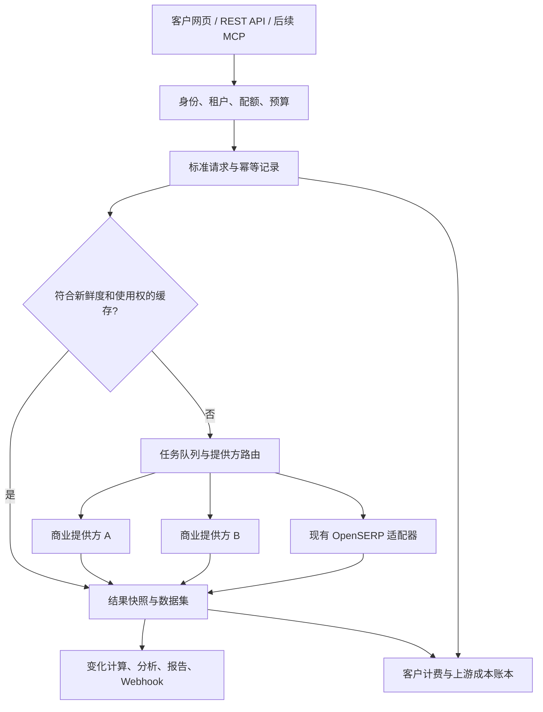

# 商业 Google 数据采集服务调研与 SearchFlow 产品方案

调研日期：2026-10-27。目标：覆盖 SEO/品牌分析、企业批量采集、AI 应用三类用户；先验证每月不超过 100,000 次搜索的产品。

本文依据厂商当日公开产品、价格和技术文档，以及 SearchFlow 本地项目记录。已实际读取官方网页，SearchFlow 首页当日返回 HTTP 200。未购买套餐、未调用付费采集 API、未进行竞品速度/准确率实测；性能、覆盖和 SLA 均为厂商声明，不作为本系统已达到的结果。下文“建议”“目标”均为拟议方案，本次未改线上服务、采集开关、数据库或项目代码。

## 1. 建议先确定的产品方向

把 SearchFlow 做成“Google 搜索数据与持续监测平台”：同一套数据，提供开发者 API、采集工作台和分析看板。

三个商业价值分别是：开发者得到稳定数据；采集用户得到可执行、可导出的任务；SEO/品牌用户得到变化、原因线索和下一步行动。三类用户共用采集能力，但任务入口、指标和交付方式不同。

早期优先购买基础搜索能力并统一接入，自己建设历史快照、分析、项目协作、预算管理和 API 产品。现有 OpenSERP 保留为受控的自有适配器候选，不能直接用过去“新增 URL/小时”的实验结论承诺商业实时 API 质量。

“覆盖所有竞品的所有功能”应拆成可验收的端点清单：主流 Google Web 能力先达标，其他 Google 垂直产品分阶段补齐。Maps、Shopping、酒店、航班、学术、专利各自是独立的数据模型与维护工作，不能用一个“支持 Google”复选框代替。

## 2. 商业服务是怎么分工的

| 类型 | 代表 | 实际出售什么 | 对 SearchFlow 的启发 |
| --- | --- | --- | --- |
| 结构化 SERP API | SerpApi、SearchAPI | 搜索结果、丰富模块、地区/语言/设备参数、稳定 JSON | 学习接口、字段、模块状态、文档及兼容策略 |
| 低成本搜索 API | Serper、Scrapingdog | 简单集成、较低单次成本、预付额度或积分 | 作为小规模验证候选；核实模块、深度与积分倍率 |
| SEO 数据基础设施 | DataForSEO | SERP + 关键词数据库 + 搜索量 + 竞品/历史分析数据 | 区分现采数据与数据库产品，用不同来源补充分析 |
| 大规模采集基础设施 | Bright Data、Oxylabs、Decodo | 采集、解析、代理、并发、任务交付与企业支持 | 学习可靠性、任务队列、成本可见性；不必早期自建同等网络 |
| 任务/Actor 平台 | Apify | 可配置采集任务、运行记录、数据集和 API | 学习无需编程的任务与开发者 API 如何复用同一执行流程 |
| SEO/AI 分析软件 | Ahrefs、Semrush | 历史排名、竞品、可见度、AI 品牌分析 | 分析产品的对标对象，不能仅对比“能否返回 JSON” |

这些角色存在交叉：采集厂商也提供 AI 输出和分析数据，分析厂商也开放 API。表格是比较角度，不是排他的分类。[S1–S17]

### 2.1 八家核心采集厂商的比较

| 服务 | 已从官方材料确认的重点 | 需要注意的边界 | 建议用途 |
| --- | --- | --- | --- |
| SerpApi | 丰富的 Google 搜索模块；独立 AI Overview、AI Mode、Trends 接口；定位；异步任务；精确参数缓存；AI 引用 | 价格偏高；不能把成功空结果和失败混淆；服务转售条款需书面许可；额外模块如何扣费逐接口确认 | 字段模型与模块覆盖标杆；复杂模块候选 |
| DataForSEO | Google Organic 的 Live/优先队列/标准队列；地区语言设备；排名及丰富模块；Labs 历史与竞品数据；Google Ads 数据 | 队列低价不等于实时；深度、运算符、像素排名、异步 AIO 会改变成本；Labs 等独立收费 | 定时监控、企业批量、关键词和竞品数据补充 |
| Serper | Google Search/Images/News/Places/Shopping 等入口；简洁 JSON；充值额度；官方声称每次实时取数、不缓存 | 不应假定与 SerpApi 的全部细分模块等价；充值有效期 6 个月；转供与数据留存按条款确认 | 基础实时搜索的首轮试用候选 |
| SearchAPI | 自然结果、广告、知识图谱、本地结果、精选摘要、相关查询；AI 模块；团队和 SLA | 小套餐与大套餐吞吐不同；价格页限制每小时使用不超过套餐额度的 20%；实际地域和模块覆盖需验 | 基础/高级搜索及备用提供方候选 |
| Bright Data | 多引擎；地理定位；JSON/HTML/Markdown；同步与异步；按成功交付收费；AIO 相关参数 | 官网速度、成功率为声明；普通请求和不同数据产品不可按一套价格计算 | 商业备用线路、原始页面和较大批处理 |
| Oxylabs | 当前产品已包含面向 AI 的 Web API Search，以及面向页面采集的 Scrape；Google JS/non-JS 分开计价 | 老 SERP 产品链接重定向至新产品；Search 的精简结果不能默认等价于 Google 完整 SERP 模块 | 企业可靠性和 AI 搜索候选；选型时先锁定产品及输出 |
| Decodo | 统一 Web Data API；Search/Scrape/Map/Crawl；Google 模板覆盖 Search、Ads、AI Mode、News、Trends 等 | 价格页“最多多少页面/爬取”是统一产品口径；不能把宣传最低单价直接当 Google 特定模板价格 | 多类数据能力与成本试用候选 |
| Scrapingdog | Google SERP Light/Advance、AI Mode、Images、Shopping、Maps、News、Trends 等；积分型统一套餐 | 200,000 credits 不等于 200,000 次 Google 搜索；Light 为 5 credits，Advance 为 10 credits | 成本对照、部分 Google 垂直模块候选 |

本表“已确认”表示官方网页列出能力，不表示已对每个国家、设备或查询实测。未确认项必须保留为未知，不将“未在页面列出”解释为“不支持”。[S1–S13]

Apify 值得额外观察：其 Google Search Scraper 已把 API、定时运行、导出、Webhook 放在同一任务产品中，还提供 AI 引用与品牌提及相关附加能力。部分附加能力额外收费。这意味着“采集 + AI + 品牌分析”的组合本身也已有竞争者；SearchFlow 应用实际工作流、质量可追溯和客户交付体验验证差异，而不只增加几个功能名。[S17]

### 2.2 价格要按同一种工作量比较

以下为美元、未计税；基准是 1 次基础 Google Web 查询、约第一页 10 条自然结果，不启用付费扩展。套餐金额是最低购买现金支出；按量折算是消耗成本，两者不同。

| 服务/模式 | 当日官方价格示例 | 100,000 次的参考消耗或购买方式 |
| --- | --- | --- |
| Serper Starter | $50 / 50,000 credits；有效期 6 个月 | 按该档位单价折算约 $100；不必为验证先买 $375 大档 |
| DataForSEO Standard | $0.60 / 1,000 SERP；平均约 5 分钟，目标周转 45 分钟 | 约 $60；适合后台任务，不能拿来承诺秒回 |
| DataForSEO Priority | $1.20 / 1,000；平均最多约 1 分钟 | 约 $120 |
| DataForSEO Live | $2.00 / 1,000；官方平均最多约 6 秒 | 约 $200 |
| Bright Data 按量 | $1.50 / 1,000 requests | 约 $150；未计免费层和促销 |
| SearchAPI BigData | $250 / 月，含 100,000 searches | $250 / 月 |
| SerpApi | $25/1,000，$75/5,000，$150/15,000，$275/30,000，均为月套餐 | 未在当日页面看到 100,000 次固定套餐，需报价；不要拿大规模隐含价代替小档实际支出 |
| Scrapingdog Standard | $90 / 月，1,000,000 credits；Light 5 credits/次，Advance 10 credits/次 | Advance 100,000 次可用此档额度；Light 100,000 次也超过 $40 档可提供的 40,000 次，需考虑套餐闲置 |
| Oxylabs | Search 页面标 $1/1,000 searches；Google Scrape 区分 JS/non-JS 与套餐 | 按目标端点分别询价/验算；Search 与完整 Google Scrape 不直接互换 |
| Decodo | 统一套餐从 $19/月起；价格页按爬取/页面给出上限 | 特定 Google 模板的倍率本次未确认，不给出 100,000 次确定报价 |

DataForSEO 的具体加价尤需注意：额外 10 条结果增加一页基础费；异步 AIO、像素坐标各增加基础费；PAA 展开按点击加费；搜索运算符存在倍率。`site:example.com` 等查询不能套用普通搜索最低价。[S5]

SerpApi 官方说明：缓存、错误和失败不扣搜索额度；成功返回的空结果仍计一次。Serper 官方说明只扣成功响应，且不缓存。缓存策略属于产品契约，不能假设所有厂商相同。[S1,S7]

结论：先对 Serper、DataForSEO 做同口径试用；SearchAPI/Bright Data 作为不同价格与可靠性维度的候选。最终选两家主备之前，还需完成真实质量测试与转供条款确认，本次没有形成已验证的供应商排名。

## 3. 功能对标：先补什么，什么算真正完成

| 功能层 | 商业产品常见能力 | SearchFlow 当前有证据的能力 | 建议与验收 |
| --- | --- | --- | --- |
| 基础 Web | 标题、URL、摘要、自然排名、域名、分页 | 已有基础 Web 与请求记录 | P0：固定查询/地区/语言/设备/深度契约；地区与语言支持列表可查询 |
| 地理与设备 | 国家、城市或坐标、语言、桌面/手机 | 现有任务有部分地区与语言，未确认完整设备/城市链路 | P0：先稳定国家与桌面/手机；P1 扩城市，不能只在 UI 添加选项 |
| 丰富模块 | 广告、PAA、相关搜索、知识图谱、精选摘要、Local Pack 等 | 高级字段存在上游透传，缺乏逐模块商业验收 | P1：每个模块有 schema、例子和支持范围；不把空字段当支持 |
| AI Search | AI Overview、AI Mode、文本块、引用、图片等 | 未确认已实现 | P1：作为独立可选模块/产品，分别记录来源和成本 |
| News | 搜索新闻模块、媒体、时间、原始链接 | Google News RSS，部分链接尚为 Google 包装地址 | P1：增加商业新闻 SERP；保留 RSS 的独立方法标记和 feed_position |
| Trends | 历史热度、地区兴趣、相关查询、话题比较、Trending Now | 主要为 Trending Now RSS；不是关键词历史曲线 | P1：历史趋势单独接入；保留归一化规则、地域、时间窗 |
| 其他 Google 垂直 | Maps/Reviews、Images、Shopping、Jobs、Scholar 等 | 未确认独立商业模块 | P2：按真实客户任务依次开放，每个都是独立产品包 |
| 任务产品 | 批量、调度、重试、Webhook、数据集与导出 | 已有任务控制、结果筛选、CSV/JSONL、共享缓存等 | P0：保留现有能力，补租户、预算、交付状态、稳定结果快照 |
| 分析产品 | 历史排名、竞品、可见度、机会与告警 | 现有主要是采集与新 URL 统计 | P1：建立固定监测面板，区分采集运营指标和客户业务指标 |
| 开放平台 | 密钥、权限、额度、计费、SDK、文档、版本、SLA | 有网页使用的内部 API，未有证据表明完成商业租户隔离和计量 | P0：新建客户 API 契约和控制面，不直接转售现有控制接口 |

现有能力判断来自项目文档与源文件，不是本次对线上所有接口的完整测试。线上冻结包与本地工作树存在差异，实施前必须逐项确认实际运行版本。[L1–L4]

### 3.1 Google 数据至少有六种，不能混称

1. SERP：某个查询在某时间、地区、语言、设备下看到的结果与模块。
2. Trends：相对热度/兴趣数据；常见网页曲线为 0–100 相对指数，不是实际搜索人数。Google 官方 Alpha API 使用一致缩放，不能机械套用网页的 0–100 规则。[S18,S19]
3. 搜索量、CPC、竞争强度：通常需要 Google Ads/关键词数据库等额外来源，不从 SERP 结果条数推算。[S20]
4. 自有网站表现：客户授权的 Search Console 点击、曝光、CTR、平均排名。不是竞争对手真实流量；API 也有聚合与行数限制。[S21]
5. Maps/评论/商家数据：独立端点与实体模型，不等于 Local Pack。
6. 搜索结果网页正文：额外的网页下载、解析和权利范围；摘要不能标成全文。

另一个重要的选型变化：Google 官方 Custom Search JSON API 已不向新客户开放，现有客户需在 2027-01-01 前迁移。它也不能作为新产品获取完整 Google SERP 的默认方案。[S22]

## 4. 如何做出差异

不要宣称下面能力“全行业独有”。Ahrefs、Semrush、DataForSEO 已提供历史、AI 可见度和竞品分析，采集商也在增加 AI 功能。差异应定位为特定客户场景里更顺畅、证据更完整或成本更可控，并通过客户试用证明。

| 差异方向 | 用户得到什么 | 建设方式 | 成功验证 |
| --- | --- | --- | --- |
| 搜索变化事件 | 不必下载两份 JSON 自己比较 | 固定参数快照；新增/消失 URL、排名变化、广告/AI 引用变化；变化 API 和 Webhook | 用户能追溯两次采样与原始证据，减少误报 |
| Web + News + Trends + AI 联合监控 | 同一主题从报道、兴趣到搜索结果的观察面板 | 统一主题/实体 ID，分面保留时间、地区与来源；允许人工确认实体 | 能说明各渠道分别发生什么；不把相关性写成因果 |
| 中文分析与海外地区监控 | 中文操作者更容易管理英文/多语搜索 | 项目模板、多语品牌别名、原文与翻译并存、地区对比 | 由目标客户完成真实任务，比较完成时间和误判率 |
| 按变化程度调度与预算 | 热点更勤采，稳定词少花钱 | 设定最小/最大间隔、优先级、每月成本上限；只在允许的时效内复用 | 相同新鲜度目标下减少实际上游成本 |
| 每个结论都有证据和质量说明 | 能分清没有结果、没支持、没采到 | 模块状态、原始快照/哈希、时间戳、解析器版本、提供方、缓存年龄 | 抽查分析结论可回到对应记录；未知值不冒充零 |
| 同一项目同时交付网页与 API | 分析师看图，开发者直接取相同数据 | 同一监测任务、稳定数据集 ID、游标、导出和事件订阅 | 网页、导出、API 数值在同快照下一致 |

后续可以接入 Instagram 等自有系统，做跨渠道品牌观察；先定义实体匹配、权限和数据语义，不能因为两个系统在同台服务器上就把内容混合计算。

## 5. 数据分析应该怎么做

### 5.1 第一批值得做的六个分析模块

| 模块 | 明确回答的问题 | 所需数据 | 不应承诺的结果 |
| --- | --- | --- | --- |
| 排名与搜索可见度 | 哪些词上升/下降？哪些页面取代了我们？ | 固定词组、地区、设备、深度、周期的 SERP 快照 | 一次查询不能代表所有用户的真实排名 |
| 竞品与关键词缺口 | 对手在哪些已监测词出现而我没出现？ | 监测词库、竞品域名、历史；可选外部关键词数据库 | 已监测词的缺口不等于全网关键词全集 |
| 内容机会 | 哪些问题、主题、页面形式反复出现？ | PAA、相关搜索、标题摘要、主题聚类 | 仅凭摘要不能断定全文质量；AI 建议要附证据 |
| 品牌与媒体观察 | 哪些媒体新提及品牌？报道主题如何变化？ | Web/News、品牌别名、实体消歧、时间戳 | 情绪识别是模型判断，需置信度与人工复核入口 |
| 热度与需求变化 | 某主题兴趣是否持续增长？地区是否有差异？ | Trends 历史；可选 Ads 搜索量 | 热度指数不是绝对市场规模或实际销量 |
| AI 引用可见度 | AIO/AI Mode 是否提及品牌、引用哪些页面？ | 固定 prompt/查询集、多次采样、引用与回答记录 | Google AI 可见度不能代表所有 AI 平台，更不能代表所有用户 |

优先上线“排名变化 + 竞品出现 + 每周报告”。AI 引用与跨来源热点紧随其后。付费关键词数据在有需求后购买，避免先花钱建设无人使用的全网数据库。[S6,S14–S16]

### 5.2 指标必须可复算

- Top-N 出现率 = 成功且覆盖所需深度的采样中，目标域名出现在 Top-N 的次数 / 同一监测面板的有效采样次数。失败不记作未出现；成功但没有该域名才算未出现。
- 排名变化 = 同参数两次有效采样的名次差。`observed=false, depth=10` 只说明未在已采前 10 条出现，不能写成“第 11 名”“第 100 名以后”或从 Google 消失。
- 监测可见度分数 = 在固定关键词集合上，以明确的排名权重计算。若无搜索量权重就显示“等权监测可见度”，不要称真实市场份额。搜索量加权与 CTR 模型需展示来源和假设。
- AI 提及率 = 提及目标实体的有效 AI 回答数 / 有效 AI 回答数；AI 引用率单独计算。没有触发 AIO 时，再分别报告 AIO 触发率及条件引用率，避免分母变化制造虚假趋势。
- 结果波动 = 相同监测单元两次 Top-N URL 集合的变化率，例如 `1 - Jaccard(A,B)`；同时保留排名变化，不只看集合。
- 新链接产出 = 归一化后首次出现的唯一 URL；与客户请求量、SERP 行数、采集成功数分开统计，不能用来替代 SEO 表现。

Trends 比较必须保留相同地域、时间窗、来源和缩放规则；网页不同批次的 0–100 曲线不能直接相加。新闻发布时间、平台索引时间、系统首次发现时间、实际抓取时间分别存储。相同文章的转载聚类与 URL 去重分开，且保留原始记录。

### 5.3 推荐的数据结构

沿用现有 PostgreSQL 与任务队列，先增加产品层和快照模型，不为 100,000 次/月立刻引入 Kafka、ClickHouse 或多集群。

| 数据实体 | 核心内容 |
| --- | --- |
| tenant / project / api_key | 客户、项目、密钥哈希、角色、scope、预算 |
| monitor_definition | 关键词/主题、地域、语言、设备、引擎、模块、深度、频次与预估成本 |
| search_request / provider_attempt | 客户请求、归一化参数、幂等键；各次上游尝试、耗时、费用和错误 |
| serp_snapshot | 不可变结果快照、采样时间、实际地域/设备、提供方、缓存年龄、schema/parser 版本 |
| result_observation | 每次快照中的 URL、标题、摘要、自然排名、模块和坐标（如有） |
| canonical_url / entity | URL 归一化、域名、品牌别名与实体映射；不覆盖原始 URL |
| ai_answer / ai_citation | 回答、文本块、引用序号与目标链接，区分供应商原文和本系统分析 |
| metric_series / change_event | 带分母和覆盖率的指标、可回溯快照的变化事件 |
| usage_ledger / webhook_delivery | 预留、结算、释放/退款、实际供应商成本、通知投递记录 |

原始响应/允许保存的 HTML 可进对象存储，数据库保存引用和哈希。保留策略按合同和租户确定；提供不留存模式时，不能同时承诺跨客户复用缓存或历史回看。AI 分析文本另存模型/版本、输入快照与生成时间，不能覆盖原始采集字段。

## 6. 开放 API 怎样设计

现有公网工作台按先前要求不加登录，是内部使用方式。商业开放需要新增 HTTPS 客户入口、租户和密钥；不要求本次改动旧站，但不能把现有任务控制、全局设置、历史导出接口原样发给客户。

### 6.1 三组 API，共享同一数据契约

| 产品 | 建议端点 | 服务对象 |
| --- | --- | --- |
| 即时搜索 | `POST /v1/search` | 程序调用、AI 应用、少量交互查询 |
| 批量任务 | `POST /v1/search-jobs`、`GET /v1/jobs/{id}`、`GET /v1/datasets/{id}/items` | 企业采集、异步导出、工作流 |
| 持续监测与分析 | `POST /v1/monitors`、`GET /v1/monitors/{id}/history`、`GET /v1/changes`、`GET /v1/analytics/visibility` | SEO、品牌与持续数据产品 |
| 平台控制 | `GET /v1/capabilities`、`GET /v1/usage`、密钥/预算管理、Webhook 订阅 | 客户与集成开发者 |

`POST /v1/search` 的输入先限制为明确支持的 `engine`、`query`、`location`、`language`、`device`、`depth`、`modules`、`freshness`。同步超时用 504 及可查询的 request_id；异步端点明确返回 202 和 job_id，不让同一个字段同时表示队列已接收和搜索成功。

响应至少包括：`request_id`、`status`、`schema_version`、`requested_parameters`、`effective_parameters`、`fetched_at`、`cache_hit`、`cache_age_seconds`、`data_source`、`module_status`、`organic_results`、`cost`。`cost` 是面向客户的费用，真实上游成本放内部账本，除非产品明确提供透明成本模式。

模块状态使用 `present / absent / unsupported / unavailable / parse_error` 等明确枚举。不要用一个空数组同时表示“Google 没展示”“供应商不支持”“抓取失败”。对必需模块与可选模块分别定义成功条件，不能模块失败仍静默标为完整成功。

AI 应用第一期可提供“SERP 标题/摘要 + 引用链接”；若增加正文/Markdown 和答案生成，作为明确的额外操作和费用。MCP 可以在 REST 契约稳定后封装搜索和查询历史，早期不必另建一套后端。

### 6.2 商业 API 的最低产品要求

- 身份与隔离：每个客户多把可撤销密钥；只存哈希；按 tenant/project 隔离任务、快照、导出、Webhook；设置管理权限与读取权限分开。错误对象 ID 也不能越权访问。
- 额度与计费：提交前原子预留预算；重试沿用同一客户请求；成功后幂等结算，失败释放；轮询和通知不重复收费。保留客户用量与供应商成本两套账，支持对账。
- 限流与公平：每租户 RPS、并发、日/月限额、单任务最大深度/模块成本；公共服务不能允许一位客户占满现有队列。429 返回 Retry-After；平台故障使用 5xx，与客户参数错误分开。
- 新鲜度：`fresh` 必须新采；`max_age_seconds` 允许显式缓存；历史查询明确返回旧快照。缓存键包括全部影响结果的参数和提供方；共享复用必须满足数据使用与租户隐私约定。
- 开发体验：OpenAPI 3.1、交互式 Playground、curl/Python/JS 示例、稳定错误码、schema 变更日志、状态页、用量/预算看板。SDK 以端点稳定为前提。
- 交付可靠性：Webhook HMAC 签名、时间戳、防重放、指数退避、重投、投递记录；按至少一次投递设计，客户用 event_id 去重。目标 URL 要防 SSRF，不允许探测内网/云元数据。

按“有效搜索工作量”计价，内部约定 1 标准单元 = 基础 Web、一个参数组合、前 10 条深度的一次成功取数；深度、AI 模块、额外抓取按价表加单元。上游实际少于 10 条但有效返回可算成功，解析失败/验证码页不得伪装成功。缓存读取和历史读取使用单独便宜档位，清楚展示是否消耗新采额度。

### 6.3 对外转供必须先锁定使用权

SerpApi 当前条款 Section 2 明确表示，没有书面许可不得出售/转售 Service 或其访问。Serper 条款禁止无增值原样镜像；DataForSEO 条款还限制用 SERP 数据与来源搜索引擎竞争。这些不是“统一禁用所有分析”的结论，但足以说明：能购买 API，不自动等于能将它原样包装成自己的商业 API。[S23–S25]

在供应商合同中逐项确认：嵌入产品、转供 API、白标、客户导出、原始数据/HTML 保留、缓存、跨客户复用、AI 输入用途、派生分析及终止后数据处置。无法确认时，将该来源标为暂不可对外转供。供应商的 Legal Shield 等宣传不等于你对所有下游用途均获许可。此处是选型事项，本次没有联系厂商或寻求用户批准。

## 7. 技术路线：早期采用混合方案

路由按能力、时效、成本、质量和合同选择，不只按价格。高级模块不支持时不能悄悄换成普通 Web。切换提供方要留下标记；不同提供方的定位、解析、页面取样可能不同，排名时间序列中要提示来源切换，避免把切源差异当市场变化。

同步客户与批量客户分队列；异步监测用便宜模式，交互请求用低延迟模式。上游超时先判断是否已接受任务，避免双重提交；需要备用线路时所有尝试归到同一请求，客户只结算约定的一次，上游多次支出留账。

100,000 次/月平均约 0.039 次/秒，但突发和任务集中调度决定并发。不要因平均低就无限接收突发。早期可把月预算作为硬限制，把每客户的并发和每日预算单独管理。

## 8. 月度成本、定价与配额

### 8.1 把内部监测与客户 API 一起算

基础工作量近似为：

`关键词数 × 地区数 × 设备数 × 每天次数 × 天数 × 搜索页数 × 独立引擎/端点数`

这只是规划公式，AI 模块或深度的收费按供应商真实规则另算，不能把两个共享一次采集的模块重复当两个独立搜索，也不能遗漏二次取数费用。

例如：500 词 × 2 地区 × 2 设备 × 每天 1 次 × 30 天 × 1 页 = 60,000 次。再给客户 API 30,000 次，留 10,000 次用于验收、新客户试用和异常冗余，就达到 100,000 次预算。每天两次监控会变成 120,000 次，仅监控就超预算。

### 8.2 一个可复算的早期成本模型

以下全为假设，不是当前账单：30,000 次实时基础 Web 走 $1/1,000 来源，60,000 次监测走 $0.60/1,000 队列，额外工作量预留 10,000 次并按 $2/1,000 估计，则上游约 $30 + $36 + $20 = $86。能否采用这些供应商对外服务取决于条款和真实测试。

| 成本 | 规划占位值 | 说明 |
| --- | --- | --- |
| 基础搜索上游 | 上例约 $86；全部实时常见约 $100–$250 | 不含多页、运算符、AI 模块、搜索量数据等额外费用 |
| API/数据库/队列/对象存储/监控 | 初步预留 $50–$200/月 | 非云厂商报价；应按现有 Azure 实际资源复算，不重复算已支付资源 |
| AI 聚类、翻译、报告 | 单列预算并设置硬上限 | 取决于模型、输入量与分析频次；不为每次搜索自动调用模型 |
| 人工、维护、客服、支付和税费 | 单独核算 | API 单价不是总运营成本 |

“10 万次搜索只花 100 美元”最多描述某种上游基础用量，不能理解为产品总成本。

### 8.3 初期如何收费

对开发者提供预付搜索额度，对分析客户提供项目/监测词与刷新频次订阅，超量和昂贵模块另外计费。免费或朋友借用也发独立密钥，设期限与预算；不共享总密钥。

先以单位经济测算定价，不立即确定售价：若某产品可变成本为 C，目标毛利率为 g，单价至少为 `C / (1-g)`；再核对套餐闲置、失败重试、备用提供方与客服成本。假如实际完全可变成本是 $1.50/1,000，60% 毛利需要约 $3.75/1,000，70% 需要约 $5/1,000。此例不是市场报价，也没有把固定研发成本自动覆盖。

纯搜索转售容易陷入低价竞争；分析订阅应围绕“节省多少监控时间、发现多少有价值变化”验证付费意愿。第一批可招募少量设计伙伴，分别代表 SEO、数据采集和 AI 三类任务，记录可复现的交付结果。

## 9. 实施顺序与验收

| 阶段 | 交付 | 通过标准 | 暂不扩大范围 |
| --- | --- | --- | --- |
| 0：事实与供应商验证 | 线上能力清单、两家来源试用、合同使用权表、计费换算 | 真实小样本数据及成本可复算；不能转供的来源标识清楚 | 不购买全年大额套餐，不恢复生产持续采集做实验 |
| 1：可供外部试用的核心 | Web 基础 API、异步任务、租户/密钥、预算账本、历史数据集、文档和用量页 | 端到端真实请求、隔离、幂等结算、限流、超时、有效空结果、失败不误扣均验证 | 不宣称所有 Google 垂直数据已齐全 |
| 2：分析与留存价值 | 固定面板、排名/竞品变化、每周报告、Webhook；接入完整 Trends/News | 报表分母、缺失数据、提供方变化、URL 去重语义清楚，全部指标可追溯 | 不把估算流量作为真实流量，不把相关性当因果 |
| 3：高级与差异化 | AI 引用分析、城市定位、预算调度、Maps/Shopping 等客户确需模块、MCP | 按模块/地区/设备逐项验收；真实客户完成任务并愿继续使用 | 不以数量取代质量，不一次铺开所有引擎 |

时间只有条件估计：若由 2 名熟悉项目的工程师持续投入、供应商账户可用且不含全量垂直引擎，阶段 0–2 可先按约 6–10 周规划，再由阶段 0 的实际问题重估。当前未完成排期，不是交付承诺。一个人开发时应进一步缩小一期模块，不按相同时间承诺。

### 9.1 供应商对照试验

建议建立 300–500 个固定查询条件，覆盖导航/资讯/交易/本地/长尾、英文/中文、目标市场和桌面/手机。每个条件在短窗口内调用两家候选，分三个时段重复；约 1,800–3,000 次调用。AI、新闻、趋势另有适用子集，费用单列。

记录：端到端成功率、模块完整率、有效空结果、实际定位/设备、重复 URL、链接规范化、延迟 p50/p95/p99、缓存年龄、最终费用、错误分类和恢复情况。某个供应商的结果不能直接作为绝对真值；在允许范围抽查原始证据，对时间/定位造成的差异标记为差异，不自动判错。

可先设“基础搜索平台完成率 ≥99%、同步 p95 ≤10 秒”为候选验收目标，再用实测调整，不作为当前承诺；异步任务按完成时限单独评估。每种语言/地区/设备看分层结果，不能只看总体成功率。

### 9.2 分析与 API 上线的关键检查

同一请求超时重试不重复计费；客户 A 无法读取客户 B 的任务/结果/导出；并发触顶与预算耗尽在上游调用前被挡住；缓存满足请求时效；Webhook 重复投递可去重；模块不支持和真实未出现被区分；未采到完整深度时排名不被伪造；失败样本不当作流量/排名下滑；报表、导出和 API 使用相同快照与指标分母。

这些是未来实现的验收项目，本次没有编写或运行相关代码测试。

## 10. 官方来源与本地依据

以下网页于 2026-10-27 实际读取。套餐和产品会变动，付费前按具体端点、地区、模块与合同重新确认。旧链接发生重定向时，本文使用读取到的新产品链接。

- [S1 SerpApi Pricing](https://serpapi.com/pricing)；[Search API](https://serpapi.com/search-api)。
- [S2 SerpApi Google AI Overview](https://serpapi.com/google-ai-overview-api)。
- [S3 SerpApi Google AI Mode](https://serpapi.com/google-ai-mode-api)。
- [S4 SerpApi Google Trends](https://serpapi.com/google-trends-api)。
- [S5 DataForSEO Google Organic 详细价格](https://dataforseo.com/pricing/google-serp/google-organic-serp-api)；[Advanced API 文档](https://docs.dataforseo.com/v3/serp/google/organic/live/advanced/)。
- [S6 DataForSEO SERP](https://dataforseo.com/apis/serp-api)；[Labs API](https://dataforseo.com/apis/dataforseo-labs-api)。
- [S7 Serper 产品、价格与 FAQ](https://serper.dev/)。
- [S8 SearchAPI Pricing](https://www.searchapi.io/pricing)；[Google 文档](https://www.searchapi.io/docs/google)。
- [S9 Bright Data SERP API 与价格](https://brightdata.com/products/serp-api)。
- [S10 Oxylabs Web API Search](https://oxylabs.io/products/web-api/search)；[Search 价格](https://oxylabs.io/products/web-api/search/pricing)；[Google JS/non-JS 所在 Scrape 产品页](https://oxylabs.io/products/web-api/scrape)。
- [S11 Decodo SERP](https://decodo.com/scraping/serp)；[统一 Web Data API 价格](https://decodo.com/web-data-api/pricing)。
- [S12 Scrapingdog Google SERP](https://www.scrapingdog.com/google-serp-api/)。
- [S13 Scrapingdog 价格与积分倍率](https://www.scrapingdog.com/pricing/)。
- [S14 Ahrefs Rank Tracker](https://ahrefs.com/rank-tracker)，含排名历史、竞争对比、SERP features 与 AI 品牌产品链接。
- [S15 Semrush Position Tracking](https://www.semrush.com/position-tracking/)。本次取得的可读正文较少，未据此给出其完整功能、具体额度或价格结论。
- [S16 Semrush AI 产品](https://www.semrush.com/ai-seo/overview/)。当日返回 HTTP 200，但取得的可读正文较少，未据此确认完整功能与精确价格。
- [S17 Apify Google Search Scraper](https://apify.com/apify/google-search-scraper)。未将不同 Actor 的价格混为 Apify 平台统一搜索价格。
- [S18 Google Trends 官方 Alpha API](https://developers.google.com/search/apis/trends)，当前为申请访问，不能假设所有客户可直接使用。
- [S19 Google Trends 数据解释](https://support.google.com/trends/answer/4365533?hl=en)。
- [S20 DataForSEO Google Ads API](https://dataforseo.com/apis/google-ads-api)。
- [S21 Search Console Search Analytics](https://developers.google.com/webmaster-tools/v1/searchanalytics/query)。
- [S22 Google Custom Search JSON API Overview](https://developers.google.com/custom-search/v1/overview)。
- [S23 SerpApi Legal / Section 2](https://serpapi.com/legal)。
- [S24 Serper Terms / Usage License 与 Data License](https://serper.dev/terms)。
- [S25 DataForSEO Terms / Section 7](https://dataforseo.com/terms-of-service)。

本地依据：

- L1：[`AGENTS.md`](../AGENTS.md)，部署、用户暂停采集、已有字段和已知限制。
- L2：[`google-sources-requirements-2026-10-10.md`](google-sources-requirements-2026-10-10.md)，Web/News/Trends 的真实语义与验收记录。
- L3：[`workbench-migration-2026-10-22.md`](workbench-migration-2026-10-22.md)，SearchFlow 迁移和内外部接口部署背景。
- L4：[`serp_console.py`](../realtime/serp_console.py)、[`serp_fields.py`](../realtime/serp_fields.py)、[`web.py`](../realtime/web.py)，现有参数、字段、路由实现；本地代码不等于已运行版本。

## 11. 尚未确定、下一步如何验证

1. 实际付费 API 的质量、速度、模块覆盖和最终费用：完成阶段 0 小样本对照；本次官网声明不替代实测。
2. API 转供、白标、缓存、长期存储及衍生使用许可：以具体供应商合同/书面答复确认，不根据宣传语推断。尚未联系厂商。
3. 优先细分行业与付费意愿：三类目标都保留，但由少量真实设计伙伴决定一期先稳定哪些查询、地区和模块。
4. 上线现状与资源成本：本次只读首页和本地记录，未 SSH 审计生产服务、未读取当前账单、未复算现有数据全量质量；实施前做只读核对。

当前最值得落实的第一步是：把“基础 Web + 外部 API 配额 + 固定关键词监测 + 有证据的变化报告”做成一个可让三类客户各完成一次真实任务的最小产品，再按客户使用数据扩展 Google 垂直模块。
